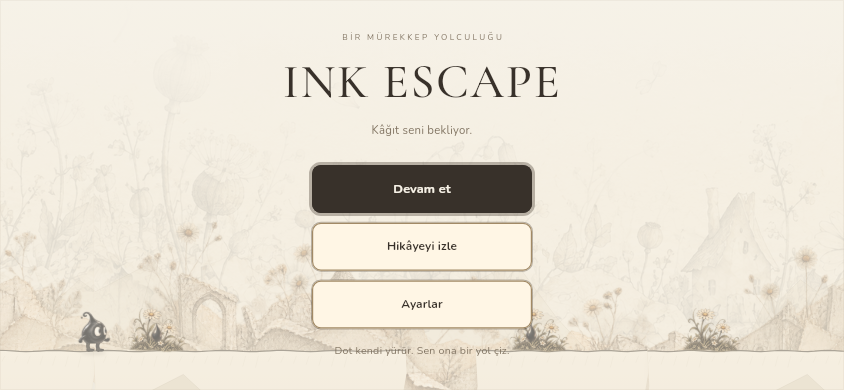
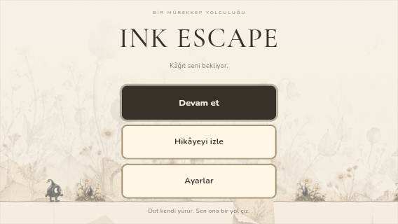

# Duvar Teması, Zıplama, Menü ve Oynanış Yükü

**Tarih:** 29 Ekim 2026. **Sürüm:** 0.3.2+5. **Ortam:** Linux x64, Flutter 3.47.2 / Dart 3.13.2.
**Test edilen uygulama:** [e10c59ac356de902e4bf6648f51e473f6f7ef3fb](https://github.com/keremozderya/ink-escape/commit/e10c59ac356de902e4bf6648f51e473f6f7ef3fb).

## İncelenen kaynak ve hatanın nedeni

Oyun deposunda `3bb08a5`, `b45b1e4`, `bd3b7e8`, `dcbe892` ve `647ec08`; Vault deposunda son çizim/dil teslimi `7adf3ea` dosya farklarıyla incelendi. `b45b1e4` açık kenarın üstündeki mürekkebe basmayı çözüyordu; karşı kıyının altında biten çizginin çıkışını kapsamıyordu. Zemin üst yüzeyi dışında dolu kâğıdın açık yan yüzü modellenmediği için ayakları üst yüzeyden aşağıdaki Dot içeri yürüyebiliyordu.

Eski kaynakla 16 u aşağıda biten köprü testi yeniden çalıştırıldı: yan yüz sınırını geçerken ayak Y=-13,38 u idi ve regresyon testi başarısız oldu. Derleme uyumluluğu için eski modele yalnız 24 u test sabiti eklendi; davranış kodu aynı tutuldu. Aynı senaryo yeni kodda geçer.

## Uygulanan davranış

- Dolu doğal kâğıdın açık sol yüzü gövde genişliğiyle süpürülür. Bağlı segment birleşimleri sahte duvar olmaz; yüksek ankraj rafları ince destek olarak kalır.
- Kısa doğal kıyı ve dik çizgi için otomatik zıplama sınırı **32 × 3/4 = 24 u**. Normal yürüyüş eğimi 55° kalır. Önceki 32 u dik yürüyüşün yerine kısa yükseltilerde havalanma/iniş gelir. Zıplama yayının tepesi engelin 4 u üzerini hedefler; 4 u, aşılabilir engel sınırını artırmaz.
- Yukarı fırlatma, yerçekimi ve iniş canlı fizik üzerinden ilerler. Dolu kâğıda içinden giriş engellenir; daha yüksek engel otomatik olarak aşılmaz. Beş dokunuşlu tutunma ve üç saniyelik takılma kuralı korunur. Çıkışta yukarıdaki çizgiye 12 u basış önceki davranış olarak kalır.
- Menüde ana eylem opak koyu mürekkep, ikincil eylemler opak sıcak kâğıt yüzey kullanır. Çerçeve, hafif gölge, kalın yazı ve en az 48 dp yükseklik uygulanır; kısa ekran kaydırılabilir.
- HUD değişiklikleri `ValueListenableBuilder` ile yalnız HUD'ı yeniler; Flame widget kimliği sabittir. Menü/tutunma/hata gibi yapısal değişiklikler ekranı yine yeniler. HUD ayrı repaint alanındadır.
- Native başlangıçta `SaveJournal(backgroundEncoding: true)` kullanılır. Snapshot koleksiyonları hemen yakalanır; JSON, zarf ve checksum ayrı isolate üzerinde kodlanır. Disk yazma sırası, iki yuva, reset fence, eski format ve hata sonrası toparlanma korunur. Beş saniyelik kayıt aralığı değişmez.

## Çalıştırılan doğrulama

| Kontrol | Sonuç |
| --- | --- |
| `flutter test --no-pub --reporter expanded` | **209/209 geçti**, 25 dosya |
| `flutter analyze --no-pub` | **No issues found** |
| `dart run scripts/verify_routes.dart --revision=e10c59ac356de902e4bf6648f51e473f6f7ef3fb` | **5/5**: story, zero-ink, two, roof, ball |
| `git diff --check` | Geçti |
| 120 kare / 60 FPS widget senaryosu | Ekran rebuild **41 → 0**, HUD **41 → 41**; bir autosave yazıldı |
| Menü yüzeyi | Opak renkler; normal durum metin kontrastı >7:1; bütün butonlar ≥48 dp |

Yeni regresyonlar: 2/8/16/24 u aşağıda biten köprüler × 30/60/120 FPS × iki çizim yönü; gerçek begin/move/end API'siyle onaylanan düşük köprü; tam 24 u doğal/dik çizgi basamağı; 24,2 u sınır üstü dik engel; yüksek kıyı; emekli çizgi ve bağlantısız boşluk; yükselişte pause/restore; zıplarken alçak tavana baş teması. Kısa çukur testleri artık yeni havalanma davranışını ve tekrar inişi doğrular.

Worker kayıt testleri: inline ile aynı baytlar ve karşılıklı okuma; kuyruğa alınmış nested snapshot'ın değişmemesi; eski disk yazması sürerken yeni fence'in kazanması; eşzamanlı kodlamalara rağmen yazma sırası ve hata sonrası toparlanma. Önceki dil, çizim, kayıt kurtarma, tutunma ve hikâye kontrolleri de tam suite içindedir.

[Kaynak hash'leri](jump-menu-source-manifest-2026-10-29.json) · [Rota raporu](route-verification-jump-menu-2026-10-29.json) · [HUD önce/sonra ölçümü](runtime-rebuilds-2026-10-29.json).

## Görsel kontrol

## Ölçümün sınırı

Widget rebuild sayısı cihaz FPS'i değildir. Sık tüm ekran yenilemesi ve oyun iş parçacığındaki kayıt kodlaması azaltıldı; bunların telefondaki bütün periyodik takılmaların kesin nedeni olduğu kanıtlanmadı. Android/iOS native derleme ve fiziksel cihaz profili bu ortamda yapılmadı. SM-S911B üzerinde profile/release build ile en az 30 dakika; özellikle 5 saniyelik kayıtlar, ses açık/kapalı, çizim, kıyı zıplaması ve bölüm geçişinde UI/raster kare süreleri kontrol edilmeli. Kayıt snapshot'ının yakalanması ve platform yazma çağrısı hâlâ ana isolate üzerindedir; yalnız kodlama worker'a taşındı.

Önceki 173 testlik [çizim/dil raporu](UX_2026-10-29.md) ve 142 testlik [kayıt/öğretici raporu](TEST_2026-10-29.md) tarihsel kanıt olarak korunur.
