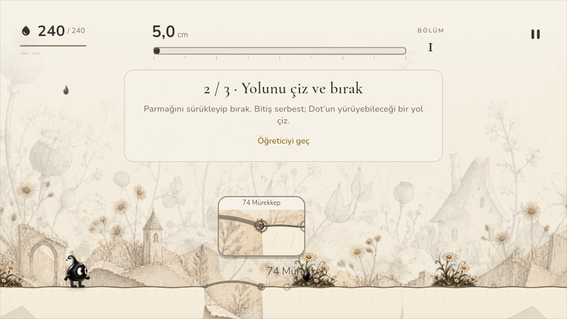
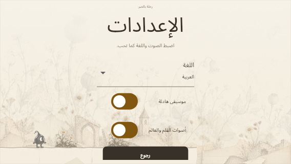
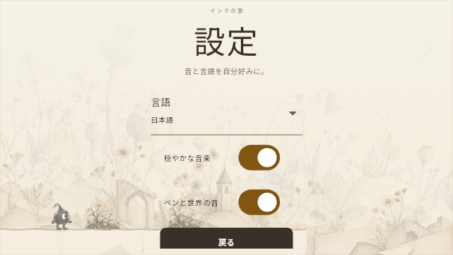

# Çizim, Animasyon, Ses ve Dil · Test Kanıtı

**Tarih:** 29 Ekim 2026. **Sürüm:** 0.3.1+4. **Platform:** Linux x64.
**Test edilen uygulama:** [b45b1e4cc0bdd384817efcd4c4acbb65f8df4060](https://github.com/keremozderya/ink-escape/commit/b45b1e4cc0bdd384817efcd4c4acbb65f8df4060). 44 değişen dosyanın Git blob SHA'ları oluşturulan uygulama ağacıyla birebir doğrulandı; bu rapor aynı kodun üzerine ayrı belge commit'i olarak eklenmiştir.

## Sonuçlar

| Kontrol | Sonuç |
| --- | --- |
| Flutter / Dart | 3.47.2 stable / 3.13.2 |
| `flutter test --no-pub` | **173/173 geçti**, 23 test dosyası |
| `flutter analyze --no-pub` | **No issues found!** |
| `dart run scripts/verify_routes.dart --revision=b45b1e4cc0bdd384817efcd4c4acbb65f8df4060` | **5/5 geçti**: story, zero-ink, two, roof, ball |
| `git diff --check` | Geçti |
| Metin kapsamı | 105 kayıt × 12 dil; eksik/boş çeviri veya placeholder farkı yok |
| Font karakter kapsamı | Katalog ve dil adlarının tüm karakterleri paketli fontların cmap birleşiminde var |
| Altı adım WAV'ı | 44,1 kHz, mono, PCM16; süre 0,198–0,223 sn; tepe 0,693–0,775; clipping yok |

[Rota raporu](route-verification-ux-2026-10-29.json) · [Test edilen kaynak hash'leri](ux-source-manifest-2026-10-29.json) · [Font kaynak ve lisans manifesti](localization-font-sources.json).

## Senaryolar

- **Çizim görünürlüğü:** 390×844, 844×390, 1024×768 dokunma; 1280×540 ve 1280×800 fare. Gerçek pointer olaylarıyla çizgi onaylanır; başlangıç/gerçek koordinat korunur. Büyüteç parmak alanının dışında ve viewport içindedir; farede açılmaz, bırakınca kapanır. Canlı maliyet büyüteç başlığında okunur.
- **Yükseltilmiş köprü:** 2/6/12 dünya birimi ve 30/60/120 FPS; kâğıt içinde başlayıp açık kenarın üstüne çıkan çizgi, karakter ilk noktayı geçtikten sonra tamamlanan köprü ve ters çizim. Devam eden zemin üstündeki çatı, yüksek/uzak veya emekli çizgi yanlış destek olmaz.
- **Animasyon:** yürüme/düşme/tutunma/iniş ağırlıkları, pause, kare hızından bağımsız sönüm ve omuz hedefinin ters gövde dönüşümü. Yokuş, kısa dik basamak, gerçek tutunma ve köşeden yürüyüş render edildi. Gövde collider'ı ve 5 dokunuş kuralı aynı kaldı.
- **Dil:** bütün 12 dilde 568×320 menü, kaydırılabilir ayarlar ve oyun içi HUD. Gerçek menü seçimiyle İngilizceden Fransızcaya canlı geçiş ve uygulama yeniden açıldığında seçimin korunması. Arapça RTL; cihaz/desteklenmeyen dil çözümü; eski Türkçe hata mesajlarını da kapsayan katalog. Arapça/Japonca yazılar render üzerinden incelendi.
- **Önceki regresyonlar:** çift kayıt kurtarma, yarım çizgi, 0–5 tutunma, geç yazma, bölüm fence'i, yeni tur mesafesi, efekt kapalıyken müzik ve öğretici testleri de aynı 173'lük tam suite içinde geçti.

## Görsel kanıt

## Korunanlar ve açık kontroller

Storyboard atlası, 12 sahnenin kaynak dikdörtgenleri/sırası ve toplam 37 saniye korunur. Yalnız metinleri dil seçimine bağlandı ve Dots yazımı Dot olarak birleştirildi. Arka plan ders notu/mektup her dilde İngilizce kaldı. Oyun hâlâ iki hikâye bölümü ve üç mekanik laboratuvarı içerir; bu teslim 298 bölüm eklemez.

Bu ortamda yeni native Android APK derlemesi ve fiziksel cihaz testi yapılmadı. SM-S911B'de büyütecin ergonomisi, 60/120 Hz animasyon hissi, telefon/kulaklıkta adım sesinin şıp-şıp niteliği ve BGM miksi, uygulamayı kapatıp açınca dil/kayıt kalıcılığı ve uzun oturum ayrıca kontrol edilmeli. Sayısal WAV kontrolü ses estetiği onayı değildir.

Özel pickup/düşüş/düşük mürekkep yüzleri, düşük Ink uyarısı, tutunma sesleri ve genel erişilebilirlik menüsü tamamlanmış sayılmaz. [Önceki 142 testlik rapor](TEST_2026-10-29.md) tarihsel olarak korunur.
